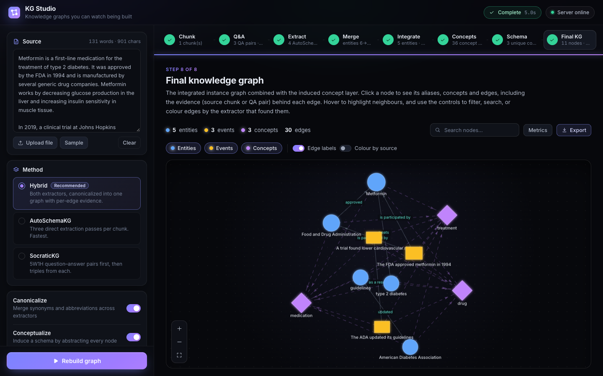
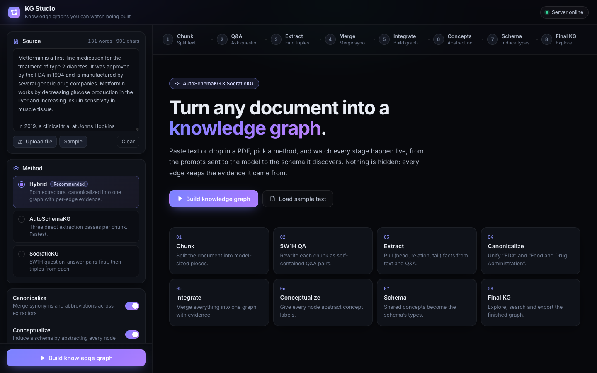
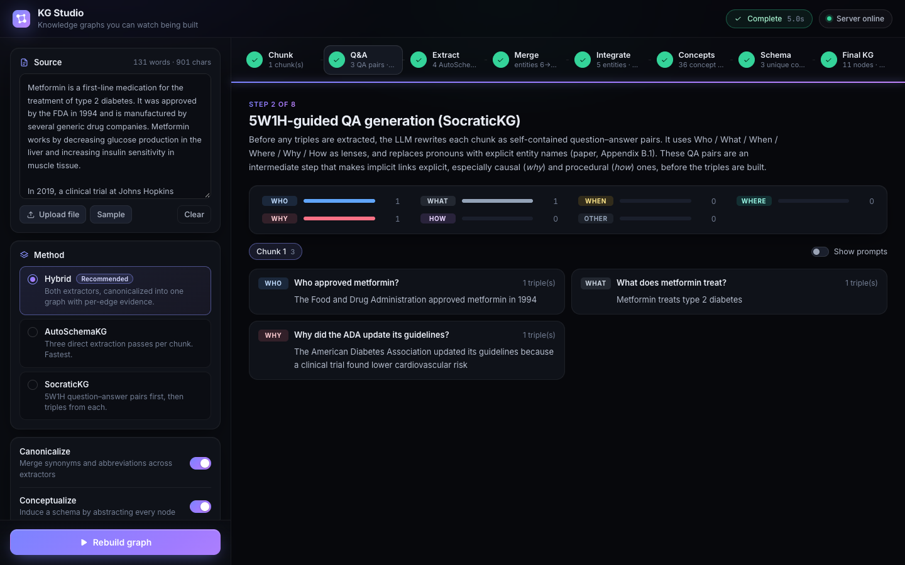
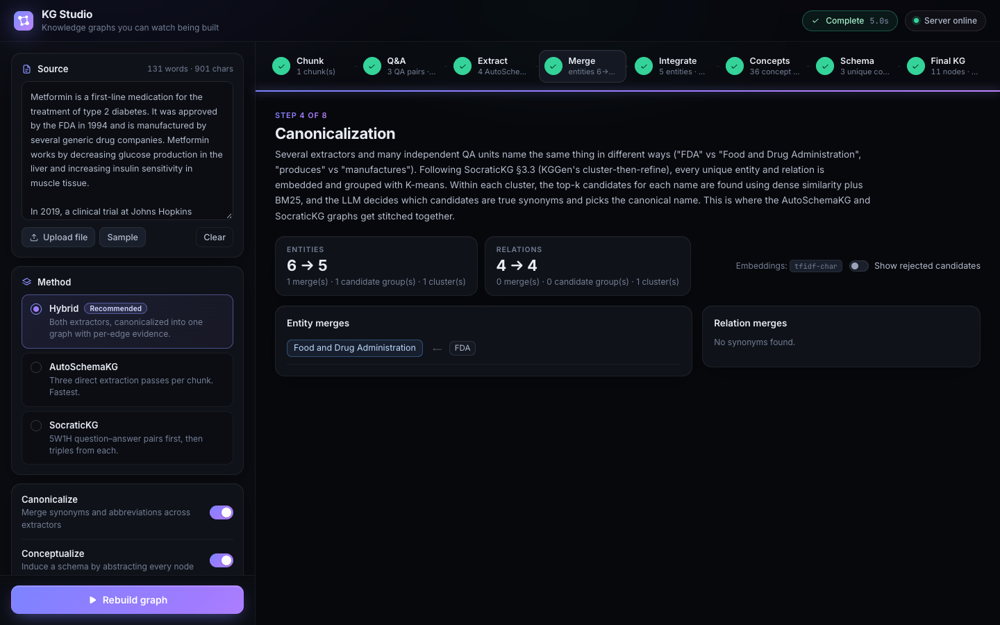

<div align="center">

# KG Studio

**Turn any document into a knowledge graph, and watch every stage happen.**

AutoSchemaKG × SocraticKG in one pipeline, with a live, step-by-step web UI.

[Quick start](#quick-start) · [How it works](#how-it-works) · [Configuration](#configuration) ·
[Troubleshooting](#troubleshooting)



</div>

## Why KG Studio

Most knowledge-graph builders are black boxes: text goes in, a graph comes out, and you're left guessing why an edge
exists. KG Studio shows the whole process. Each of the eight stages opens in its own view, with the exact prompt sent
to the model, the raw reply, and what was kept or discarded. Every edge in the final graph keeps the evidence it came
from.

It combines two schema-free methods:

| | What it contributes |
|---|---|
| **[AutoSchemaKG](https://github.com/HKUST-KnowComp/AutoSchemaKG)** (HKUST, `atlas-rag` on PyPI) | Direct entity / event / relation extraction, then *conceptualization*, which induces a schema without you defining one |
| **[SocraticKG](https://aclanthology.org/2026.findings-acl.1951)** (Findings of ACL 2026) | Rewrites text as self-contained 5W1H question–answer pairs first, which surfaces causal and procedural links that direct extraction misses |

An embedding + LLM **canonicalization** step then merges both into one graph. You can run either method alone, or
both together (*Hybrid*, the default).

> [!NOTE]
> The hybrid pipeline combines two published methods; the combination itself is not a validated system from either
> paper. KG Studio reports SocraticKG's structure metrics per extractor and before/after canonicalization, so you can
> judge whether it helps on your own documents.

---

## Quick start

You need **Docker** and **an LLM**. KG Studio doesn't ship a model; it talks to one you point it at.

```bash
git clone https://github.com/<your-username>/kg-studio.git
cd kg-studio
cp .env.example .env          # then set your LLM (see below)
docker compose up -d --build  # first build: ~5–10 min
```

Open **http://localhost:8000**, click **Build knowledge graph**, and watch it run.

<details>
<summary><b>Pick your LLM</b> (edit <code>.env</code>, keep only one block)</summary>

**A) An Ollama-style server you already run** (local, VPN, or a university/company endpoint)

```ini
LLM_PROVIDER=ollama
LLM_BASE_URL=http://host.docker.internal:11434   # same machine; otherwise the server's IP
LLM_MODEL=qwen2.5:7b-instruct
```

**B) Let KG Studio start Ollama for you** (needs ~8 GB RAM and ~5 GB disk for a 7B model)

```ini
LLM_PROVIDER=ollama
LLM_BASE_URL=http://ollama:11434
LLM_MODEL=qwen2.5:7b-instruct
```

Start with `docker compose --profile ollama up -d --build` instead. The model downloads on first start; follow it
with `docker compose logs -f ollama-pull`.

**C) OpenAI or any OpenAI-compatible API** (Groq, Together, vLLM, LM Studio, llama.cpp…)

```ini
LLM_PROVIDER=openai
LLM_BASE_URL=https://api.openai.com
LLM_MODEL=gpt-4o-mini
LLM_API_KEY=sk-...
```

Instruction-tuned models of 7B+ give usable results; 20B+ give noticeably cleaner triples.

</details>

### Check the LLM is reachable

The UI deliberately has no LLM settings; everything lives in `.env`. To confirm the connection:

```bash
curl -X POST http://localhost:8000/api/health
# {"ok": true, "reply": "pong", "seconds": 0.8}
```

If you get `"ok": false`, see [Troubleshooting](#troubleshooting). After editing `.env`, apply it with
`docker compose up -d`.

---

## Using the app



**1. Add your text.** Paste it, click **Sample**, or drag a **PDF, TXT, MD or JSON** file (`[{"text": "..."}]`)
onto the Source panel.

**2. Pick a method.**

| Method | Best for |
|---|---|
| **Hybrid** *(recommended)* | Highest coverage: both extractors, merged with per-edge evidence |
| **AutoSchemaKG** | Speed: three direct extraction passes per chunk |
| **SocraticKG** | Causal / procedural text: Q&A pairs first, then triples from each |

**3. Choose what runs.** **Canonicalize** merges synonyms and abbreviations ("FDA" = "Food and Drug
Administration"). **Conceptualize** induces the schema. Turn either off for a faster, rawer graph.

**4. Build.** The pipeline rail at the top lights up step by step, with a live timer. The view follows the running
step automatically; click any step to look inside it, and **Follow live** to jump back. The **Activity** panel lists
every model request as it happens.

**5. Explore the result.** In **Final KG**:

- **Hover** a node to highlight its neighbours; **click** it for aliases, concepts and every edge.
- Click an edge's badge (`AS`, `SoKG` or `both`) to see its **evidence**: the source chunk, or the exact Q&A pair.
- Filter by node type, search, toggle edge labels, colour edges by extractor, and open **Metrics**.
- **Export** the graph as RDF **JSON-LD**, JSON or GraphML (also saved to `output/ui_runs/<date-time>/`).

In any step, flip **Show prompts** to see exactly what was sent to the model and what it replied.

<details>
<summary><b>Advanced options</b></summary>

| Option | What it does |
|---|---|
| Prompt language | AutoSchemaKG prompt language: `en`, `zh-CN`, `zh-HK` |
| Chunk size / overlap | How the text is split. Smaller chunks mean more, shorter model calls |
| QA pairs per call | SocraticKG only. `1` matches the paper; 3–5 means far fewer calls |
| Max nodes to conceptualize | Conceptualize only the N most-connected nodes |

</details>

---

## How it works

| # | Step | Method | What happens |
|---|---|---|---|
| 1 | **Chunk** | both | Text is split into ≤ `chunk_size` character chunks with AutoSchemaKG's `TextChunker` |
| 2 | **5W1H Q&A** | SocraticKG | Each chunk is rewritten as standalone question–answer pairs with pronouns resolved (paper App. B.1) |
| 3 | **Extract** | both | AutoSchemaKG: entity–entity, event–entity and event–event passes. SocraticKG: atomic triples per Q&A pair (App. C.1), dropping pronoun or clause-like entities |
| 4 | **Canonicalize** | both | Embeddings → K-means → dense + BM25 candidates → the LLM confirms synonyms (KGGen, as used in SocraticKG §3.3) |
| 5 | **Integrate** | both | One directed multigraph; every edge keeps its sources and evidence |
| 6 | **Conceptualize** | AutoSchemaKG | Each entity, event and relation gets abstract concept phrases |
| 7 | **Schema** | AutoSchemaKG | Concepts become `Concept` nodes linked by `has_concept`; shared concepts form the schema |
| 8 | **Final KG** | — | Interactive graph, structure metrics, export |

<table>
<tr>
<td width="50%"></td>
<td width="50%"></td>
</tr>
<tr>
<td align="center"><sub>Step 2: SocraticKG's 5W1H Q&A pairs</sub></td>
<td align="center"><sub>Step 4: canonicalization stitches the two extractors together</sub></td>
</tr>
</table>

**Structure metrics** (SocraticKG §4.1) appear in steps 5 and 8 and in `metrics.json`: triple count, average degree
`2E/N`, and the Normalized Fragmentation Index `NFI = (C−1)/(N−1)` (0 = fully connected, 1 = fully fragmented).
They are reported for the whole graph, per extractor, and before/after canonicalization.

### Output files

Each run writes `output/ui_runs/<date-time>/`, and the same files are under **Export** in the app:

| File | Contents |
|---|---|
| `graph.jsonld` | **The final graph as RDF (JSON-LD 1.1)**: triples, provenance and concept layer. See [RDF / JSON-LD](#rdf--json-ld) |
| `graph.json` | Nodes (type, aliases, concepts, sources) and edges (relation, sources, evidence) |
| `graph.graphml` | The same graph for NetworkX, Gephi, Cytoscape, yEd… |
| `extraction.json` | Chunks, Q&A pairs, every raw triple with provenance, canonicalization maps |
| `concepts.json` | Concepts induced for each node and relation |
| `metrics.json` | Structure metrics |

### RDF / JSON-LD

`graph.jsonld` is standard RDF, so it loads into any triple store (GraphDB, Fuseki, Stardog, Neo4j n10s…) or
library (`rdflib`, Apache Jena, `jsonld.js`). It contains:

- **Every fact as a plain triple**, e.g. `node:food_and_drug_administration rel:approved node:metformin`. Each
  relation is declared as an `rdf:Property`.
- **Entities and events** typed `kg:Entity` / `kg:Event`, with `rdfs:label`, and `skos:altLabel` for the names that
  canonicalization merged.
- **Concepts** as `skos:Concept`, linked from instances (and relations) by `kg:hasConcept`.
- **Provenance** as `rdf:Statement` reification: which extractors found the fact (`kg:extractedBy`), how often
  (`kg:count`), and its `kg:evidence` (source chunk, the SocraticKG Q&A pair, the wording as extracted).

```json
{
  "@id": "node:food_and_drug_administration", "@type": "Entity",
  "label": "Food and Drug Administration", "altLabel": ["FDA"],
  "rel:approved": [{ "@id": "node:metformin" }]
},
{
  "@type": "rdf:Statement",
  "subject": "node:food_and_drug_administration", "predicate": "rel:approved", "object": "node:metformin",
  "extractedBy": ["autoschema", "socratic"], "count": 2,
  "evidence": [{ "@type": "Evidence", "extractedBy": "socratic", "chunk": 0,
                 "question": "Who approved metformin?", "answer": "The Food and Drug Administration approved metformin in 1994." }]
}
```

IRIs are minted under `urn:kgstudio:` by default. Set `RDF_BASE_IRI` (e.g. `https://example.org/kg/`) to publish
them under your own namespace.

```python
from rdflib import Graph
g = Graph().parse("output/ui_runs/<run>/graph.jsonld", format="json-ld")
print(len(g), "triples")
```

### How many LLM calls?

Per chunk: **3** (AutoSchemaKG) + **1 + one per Q&A pair** (SocraticKG). Then a few canonicalization calls, plus
**one per node** for conceptualization. SocraticKG reports 2–3× the tokens of direct extraction in exchange for
better coverage. To go faster, raise `LLM_CONCURRENCY`, set **QA pairs per call** to 3–5, or lower **Max nodes to
conceptualize**.

---

## Configuration

All configuration lives in `.env` (copy `.env.example`). Real environment variables override it.

| Variable | Default | Meaning |
|---|---|---|
| `LLM_PROVIDER` | `ollama` | `ollama` (`POST /api/generate`) or `openai` (`POST /v1/chat/completions`) |
| `LLM_BASE_URL` | `http://localhost:11434` | Base URL of the LLM server, without the path |
| `LLM_GENERATE_PATH` | per provider | Override the endpoint path |
| `LLM_MODEL` | `gpt-20b` | Model name sent to the server (and pulled by the bundled Ollama) |
| `LLM_API_KEY` | *(empty)* | Sent as `Authorization: Bearer …` when set |
| `LLM_TIMEOUT` | `600` | Seconds to wait for one reply |
| `LLM_TEMPERATURE` | `0.1` | Sampling temperature |
| `LLM_CONCURRENCY` | `4` | Parallel requests per run. Raise it if your server can take it |
| `LLM_MAX_TOKENS` | `4096` | Completion budget per request. Raise it if replies get cut off |
| `RDF_BASE_IRI` | `urn:kgstudio:` | Base for the IRIs in `graph.jsonld`, e.g. `https://example.org/kg/` |
| `EMBED_MODEL` | `BAAI/bge-small-en-v1.5` | Sentence-transformers model for canonicalization; `tfidf` = no model |
| `STUDIO_PORT` | `8000` | Host port (Docker) |
| `PORT` | `8000` | Backend port (without Docker) |
| `OLLAMA_VERSION` | `0.12.3` | Bundled Ollama image tag |
| `KGSTUDIO_OUTPUT_DIR` | `output/ui_runs` | Where runs are saved |

---

## Running without Docker

For development, or if you can't use Docker. Needs **Python 3.10+**, **Node.js 18+** and `make` (on Windows, use
[WSL](https://learn.microsoft.com/windows/wsl/install)).

```bash
make setup     # creates .venv, installs backend + UI, creates .env
make dev       # backend on :8000 + hot-reloading UI on http://localhost:5173
```

Outside Docker, a model on your own machine is simply `LLM_BASE_URL=http://localhost:11434`. Option B (bundled
Ollama) is Docker-only; install [Ollama](https://ollama.com/download) yourself and run
`ollama pull qwen2.5:7b-instruct`.

`make serve` builds the UI and serves everything from **http://localhost:8000** without hot reload. `make help` lists
every command.

<details>
<summary><b>Everyday Docker commands</b></summary>

| Task | Command |
|---|---|
| Stop | `docker compose --profile ollama down` (or `make down`) |
| Start again | `docker compose up -d` (add `--profile ollama` for option B) |
| Logs | `docker compose logs -f studio` (or `make logs`) |
| Apply `.env` changes | `docker compose up -d` |
| Update | `git pull && docker compose up -d --build` |
| Different port | `STUDIO_PORT=8080` in `.env`, then `docker compose up -d` |

</details>

---

## Development

```bash
make test     # backend tests (fake LLM, offline) + UI type-check and build
make lint     # lint the UI
```

The backend tests use an in-process fake LLM and TF-IDF embeddings, so they need no network, model or GPU. They run
all three methods against both the Ollama-style and the OpenAI-style providers.

API docs are at **http://localhost:8000/docs** while the backend runs:

| Endpoint | Purpose |
|---|---|
| `POST /api/pipeline` | Run the pipeline; streams NDJSON events |
| `POST /api/upload` | Extract text from PDF / TXT / MD / JSON |
| `GET /api/download/{run}/{file}` | Download a run's output file |
| `POST /api/health` | Ping the configured LLM |
| `GET /api/healthz` | Liveness (no LLM call) |
| `GET /api/config` | UI options (prompt languages) |

**Adding a pipeline step:** emit an event in `pipeline.py`, handle it in `studio/web/src/usePipeline.ts`, add a view
in `studio/web/src/components/StepViews.tsx`, and add a test in `tests/test_pipeline.py`.

<details>
<summary><b>Project layout</b></summary>

```
.
├── studio/
│   ├── backend/kgstudio/        FastAPI package
│   │   ├── app.py                   API routes; also serves the built UI
│   │   ├── pipeline.py              the 8-step pipeline, streamed as NDJSON
│   │   ├── socratic.py              SocraticKG prompts (verbatim from the paper) + parsers
│   │   ├── autoschema.py            parsers for AutoSchemaKG replies (prompts come from atlas-rag)
│   │   ├── canonicalize.py          embedding/BM25 candidates + LLM synonym resolution
│   │   ├── graph.py                 evidence-carrying multigraph, GraphML export
│   │   ├── rdf.py                   RDF JSON-LD export (triples + reified provenance)
│   │   ├── metrics.py               avg degree, NFI, …
│   │   ├── llm.py                   Ollama / OpenAI-compatible client
│   │   └── config.py                settings from .env / environment
│   ├── backend/tests/           pytest suite (fake LLM, offline)
│   ├── web/src/                 React + Vite + TypeScript UI
│   │   ├── App.tsx                  shell: sidebar, pipeline rail, welcome screen
│   │   ├── usePipeline.ts           reduces the event stream into UI state
│   │   ├── index.css                design system (tokens, components)
│   │   └── components/              StepViews, GraphCanvas, icons, graph colours
│   ├── docs/                    README screenshots
│   └── Dockerfile
├── scripts/                     setup.sh, dev.sh
├── docker-compose.yml
├── Makefile
└── .env.example                 copy to .env
```

AutoSchemaKG isn't vendored. It's installed from PyPI (`atlas-rag==0.0.5.post1`), and its code, benchmarks and docs
stay in [the upstream repository](https://github.com/HKUST-KnowComp/AutoSchemaKG).

</details>

---

## Troubleshooting

| Symptom | Fix |
|---|---|
| Header says **Server offline** | The backend isn't running or is still starting (it takes a few seconds). `docker compose ps` / `docker compose logs studio`, or check the `make dev` terminal |
| A step fails with `ConnectError` or a timeout | `LLM_BASE_URL` isn't reachable *from where the backend runs*. In Docker, `localhost` is the container: use `host.docker.internal` or the server's IP. Connect to your VPN first if needed |
| `404 Not Found` from the LLM | Wrong provider or path. Ollama-style servers need `LLM_PROVIDER=ollama`, OpenAI-style need `openai`, or set `LLM_GENERATE_PATH` |
| `401` / `403` from the LLM | Set or fix `LLM_API_KEY` |
| A step shows *0 triples* / *No valid items were parsed* | Flip **Show prompts** to read the raw reply. Small models often break the JSON format: try a larger instruction-tuned model or raise `LLM_MAX_TOKENS` |
| Runs are very slow | See [How many LLM calls?](#how-many-llm-calls). Raise `LLM_CONCURRENCY`, batch Q&A pairs, or cap conceptualization |
| *TF-IDF was used instead* in Canonicalize | The embedding model couldn't be downloaded (offline local install). It still works, less accurately. The Docker image ships the model |
| Bundled Ollama: `model not found` | The download hasn't finished: `docker compose logs ollama-pull` |
| `env_file … required` is invalid | Compose is older than v2.24; update Docker Desktop / the Compose plugin |
| Port 8000 in use | Docker: `STUDIO_PORT=8080` in `.env`. Local: `PORT=8080 make dev` |
| Linux: `Permission denied` writing `output/` | `sudo chown -R 1000:1000 output` (the container runs as UID 1000) |

---

## Credits

- **AutoSchemaKG** / `atlas-rag`: Bai et al., *AutoSchemaKG: Autonomous Knowledge Graph Construction through Dynamic
  Schema Induction from Web-Scale Corpora*, HKUST KnowComp. [Code](https://github.com/HKUST-KnowComp/AutoSchemaKG)
  (MIT).
- **SocraticKG**: Choi, Jeon, Yang & Kim, *SocraticKG: Knowledge Graph Construction via QA-Driven Fact Extraction*,
  Findings of ACL 2026, pp. 39149–39169. [Paper](https://aclanthology.org/2026.findings-acl.1951) ·
  [Code](https://github.com/LABA-SNU/SocraticKG).
- **KGGen** canonicalization: Mo et al., 2025.

KG Studio is released under the [MIT License](LICENSE).
